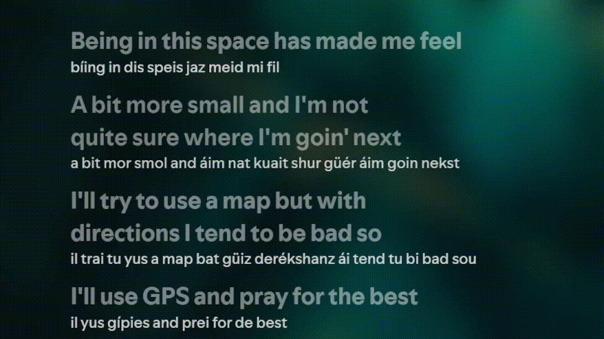

# 🔤 Phonetic Lyrics

A [Spicetify](https://spicetify.app/) extension that helps you **sing along to English songs** even if you don't know how to pronounce them. It adds a button next to Spotify's lyrics icon that, once toggled on, writes an approximate pronunciation guide (in "Spanish-reader-friendly" spelling) right below each lyric line — directly inside Spotify's native Lyrics panel, no popups or extra windows involved.

```
It was late at night, you held on tight
it uaz leit at nait, iú jeld an tait
```

---

## 🎬 Preview

<!--
  GIF showing the extension in action goes here:
  1. Playing an English song with the Lyrics panel open
  2. Clicking the 🔤 button
  3. The phonetics appearing line by line under each verse
-->



---

## ✨ What it does

- **🔤 One button, that's it** — sits right next to Spotify's native Lyrics icon. One click turns the phonetics on, another click turns them off.
- **🧠 Smart automatic conversion** — this isn't a "swap the text" trick; it uses a real English pronunciation dictionary (135,000+ words) to generate the phonetics, not made-up guesswork rules.
- **📍 Shows up right where you're already looking** — the phonetics get injected right below each line inside Spotify's own native Lyrics panel, not in a floating window covering something else.
- **🎯 Follows the song live** — as the active line changes in Spotify, the phonetics follow along with it.

---

## 🗂️ Project structure

```
phonetic-lyrics/
├── phonetic-lyrics.js   # All of the extension's logic (single file, no build step)
├── manifest.json        # Metadata for installing it from the Spicetify Marketplace
├── preview.gif          # Preview gif for the Marketplace
└── README.md             # This file
```

Inside `phonetic-lyrics.js`, the code is split into clearly separated blocks:

| Block | What it does |
|---|---|
| **1. Styles** | Injects the CSS for the button and for the phonetic text added below each line. |
| **2. CMU dictionary + conversion engine** | Downloads (once per session) the [CMU Pronouncing Dictionary](https://github.com/words/cmu-pronouncing-dictionary) and translates its phonetic symbols (ARPAbet) into a readable Spanish-spelling approximation. Also includes a short list of common song exceptions and contractions (`the`, `won't`, `going to`, etc.) that always take priority. |
| **3. Storage & API** | Fetches the original lyrics for the current track from Spotify. |
| **4. Inline injection & sync** | Finds the lyric lines Spotify has already rendered in the DOM and appends the phonetics below them, re-checking periodically to stay in sync as lines or songs change. |
| **5. Button** | Creates the 🔤 icon and places it right before the native Lyrics button. |

---

## 📦 Installation

1. Copy `phonetic-lyrics.js` into your Spicetify extensions folder:
   - **Windows**: `%appdata%\spicetify\Extensions\`
   - **macOS/Linux**: `~/.config/spicetify/Extensions/`

2. Register it and apply the changes:
   ```bash
   spicetify config extensions phonetic-lyrics.js
   spicetify apply
   ```

3. Restart Spotify. You should see the 🔤 icon next to the Lyrics button in the bottom bar.

> 💡 You can also install it from the **Spicetify Marketplace** by pushing this project to a GitHub repo and pasting the URL under the "Extensions" → "Custom" tab (remember to fill in your details in `manifest.json`).

---

## ▶️ How to use it

1. Play an English song.
2. Open Spotify's **Lyrics** panel (the native icon).
3. Click the 🔤 icon right next to it.
4. Done — the phonetics appear below each line, in real time.
5. Click 🔤 again to turn them off.

---

## ⚠️ Good to know

- The phonetics are an **approximation meant for singing along**, not an exact linguistic transcription (it's not real IPA).
- For words with more than one possible pronunciation depending on context (`read`, `live`, `tear`...), only one is used — it may not always be the right one for that particular line.
- Needs an internet connection the first time you turn it on in a Spotify session, to download the pronunciation dictionary. If there's no connection, phonetics just won't be generated for that session.
- If Spotify updates the design of its Lyrics panel, the extension may stop finding where to inject the text until the selectors inside `phonetic-lyrics.js` are updated.
- No copyrighted lyrics are stored or redistributed anywhere: the extension only reads the lyrics from your own Spotify session, the same way the native "Lyrics" feature does.

---

## 🙏 Credits

- [CMU Pronouncing Dictionary](https://github.com/words/cmu-pronouncing-dictionary) (Carnegie Mellon University, BSD license) — the backbone of the automatic phonetic conversion.
- [Spicetify](https://spicetify.app/) — for making this kind of extension possible.